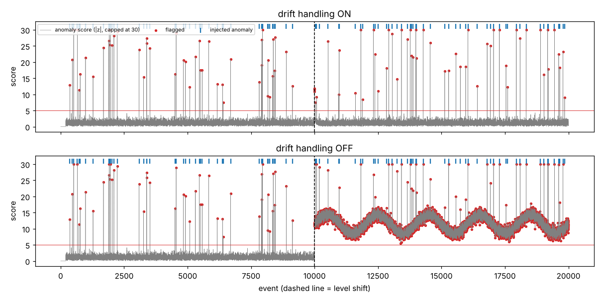

# streaming-anomaly-ml

A streaming anomaly detector that survives concept drift. Events flow producer → bounded queue → consumer. An online model scores **and updates on every event**. A Page-Hinkley drift detector triggers **windowed retraining**. Metrics are exposed in Prometheus format.



## Setup
```bash
cd ml/streaming-anomaly-ml
python3.12 -m venv .venv && . .venv/bin/activate
pip install -r requirements.txt        # only matplotlib (plot) and pytest: the pipeline itself is stdlib
```

## Usage
```bash
python -m pytest -q     # 6 tests, ~1 s
python run.py           # 20k events with a level shift, ON vs OFF drift handling, ~3 s → results/
```
```python
from streaming.model import Detector
from streaming.pipeline import run, serve_metrics, Metrics
from streaming.stream import events
m = Metrics(); serve_metrics(m, port=9108)        # curl localhost:9108/metrics
results, m, secs = run(events(20000, shift_at=10000), Detector(2), metrics=m)
```

## Architecture
```
events() ─► produce() ─► queue.Queue(maxsize=1000) ─► consume() ─► Detector.process(x) ─► (score, flagged)
 (thread)      backpressure: put() blocks when full       (thread)        │
                                                                          ├─ EWMA mean/var per feature (α=0.01): z-scores,
                                                                          │  score = max |z|, anomaly if > 5; updated after
                                                                          │  scoring, but NOT on flagged events (no poisoning)
                                                                          ├─ Page-Hinkley per feature on z (δ=1, λ=50)
                                                                          └─ drift → refit mean/var on the most recent
                                                                             window (last 75 of 300 events), reset detectors
Metrics (lock-protected) ─► http.server GET /metrics: stream_events_total, stream_anomalies_total,
                            stream_drift_detections_total, stream_queue_depth, stream_processing_seconds_{sum,count}
```
Design choices:
- **Transport.** The SPEC allows a stdlib queue instead of Kafka/Redpanda. `queue.Queue(maxsize)` gives ordering, backpressure and an end-of-stream sentinel with zero dependencies. `produce()` and `consume()` are the only two functions to swap for a Kafka client (`shortcut:` noted in `pipeline.py`).
- **Online model.** A hand-rolled estimator is enough here; `river` would be a dependency for two EWMAs. Flagged events don't update the model, so an outage cannot quietly become the new normal. But that same rule means a *real* shift would be flagged forever. The drift detector resolves the conflict: a sustained shift in the residuals is recognised as drift, and the model is refit on recent data.
- **Data.** Seeded synthetic telemetry (`latency_ms`, `payload_kb`) with daily seasonality and 0.5 % injected spikes. At event 10 000 a level shift makes latency 60 % higher, like a bad deploy.

## Results (`python run.py`, seed 0, 4 vCPUs)
| run | segment | precision | recall | false alarms | events |
|---|---|---|---|---|---|
| drift handling ON | before drift | 1.000 | 1.000 | 0 | 10000 |
| drift handling ON | first 500 after drift | 0.286 | 0.667 | 5 | 500 |
| drift handling ON | later after drift | **1.000** | **1.000** | **0** | 9500 |
| drift handling OFF | before drift | 1.000 | 1.000 | 0 | 10000 |
| drift handling OFF | first 500 after drift | 0.006 | 1.000 | 497 | 500 |
| drift handling OFF | later after drift | 0.005 | 1.000 | **9453** | 9500 |

- **With drift handling:** exactly one drift detection, at event 10 006 (6 events after the shift). The last false alarm comes 4 events after the shift. Afterwards the detector is quiet again and still catches every injected anomaly. It makes 19 697 per-event model updates.
- **Without:** every post-shift event is an alarm, which makes the detector useless.
- Throughput: 130-180 k events/s through the two-thread queue pipeline, in pure Python (~5-8 µs per event).
- Tests cover:
  - EWMA convergence;
  - Page-Hinkley fires on a shift but not on stationary noise;
  - per-event updates, with no update on anomalies;
  - **the drift test** on a seed not used for tuning: >5000 false alarms without drift handling vs <20 with it, recall > 0.8 before and after;
  - in-order processing through a 10-slot queue and the `/metrics` endpoint;
  - no spurious drift on a long seasonal stream.

**Debugging note.** With Page-Hinkley δ = 0.5 the detector "found drift" about every 1000 events on stationary data. The EWMA lags the daily seasonality, which leaves a ~0.6σ residual, and δ = 0.5 let that accumulate. δ = 1.0 was chosen on seeds 0-2 and gives exactly one detection per seed, 6 events after the real shift. The regression test runs on another seed.

## Not done (time box)
A Kafka/Redpanda transport, multivariate (correlation-aware) scoring, seasonality-aware baselines (e.g. Holt-Winters), gradual-drift scenarios, a long-running service wrapper.
